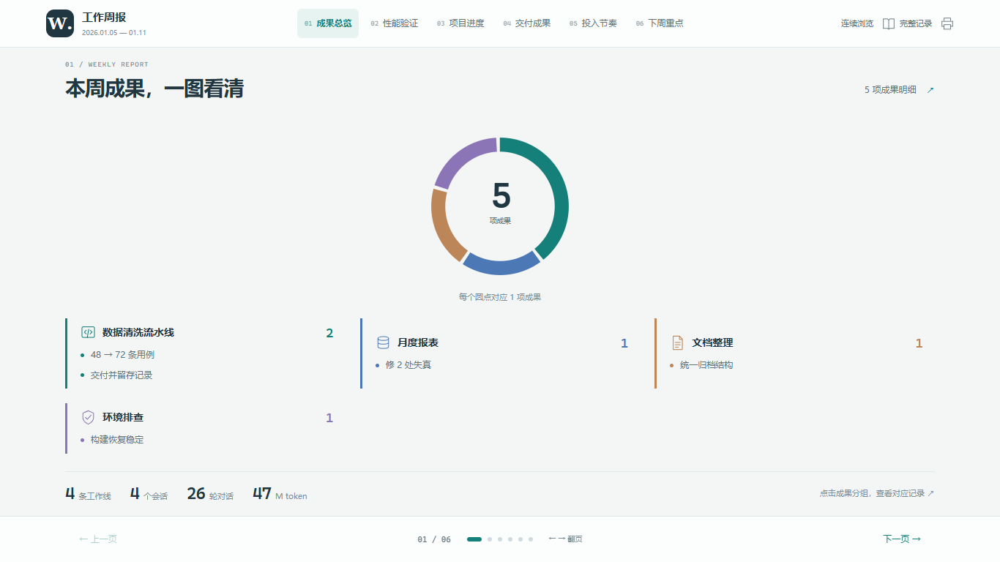

# claude-weekly

把本机 Claude Code 的会话记录，整理成一份以图为主、文字按需展开的周报（单文件 HTML，离线可开）。



> 上图由随包的**虚构示例数据**生成，项目名和数字都是编的。

## 它和现成工具的区别

GitHub 上做 Claude Code 周报的项目基本都是**用量仪表盘**：token、花费、时长、活跃热力图。它们回答的是「我花了多少、几点在干活」。

这套方案回答的是「**我做了什么**」。差别在于后者需要读懂对话内容做语义归纳，纯解析器做不到，所以流程是：

- **程序负责**：采集会话、统计轮次与 token、算日期与热力图、校验数据一致性、渲染图表。这部分每次运行结果相同。
- **模型负责**：读原始对话，提炼成果、决策、下周事项。这部分写进 `report.json`，由人复核。

生成器只排版已整理好的数据，不会自己推断发生过什么。

## 依赖

- Python 3.9+，`python -m pip install -r requirements.txt`
- [claude-weekly-worklog](https://github.com/ctshih/claude-weekly-worklog) 的采集器 `worklog_stats.py`（本方案复用它读 Claude 会话记录）
- 想跑浏览器验收还需要 `requirements-dev.txt` 里的 Playwright 与本机 Chrome

## 用之前先改路径

编辑 `report_config.json`，填上你自己的三处路径：

```json
{
  "claude_config_dir": "C:/Users/你的用户名/.claude",
  "worklog_root": "C:/Users/你的用户名/.claude/worklog",
  "collector": "C:/Users/你的用户名/.claude/skills/claude-weekly-worklog/scripts/worklog_stats.py"
}
```

`CLAUDE.md`、`数据格式.md` 里的 `<方案目录>`、`<Claude 配置目录>` 也要相应替换。

## 四步出一份周报

```bash
# 1. 采集某一周（生成 stats.json、plan.json 和空白 report.json）
python weekly_report.py collect --start 2026-01-05 --end 2026-01-11

# 2. 读原始对话补摘要、整理成果 —— 这步交给 Claude Code 做，
#    它会按 CLAUDE.md 的约定逐回合读证据、填 data/<周期>/report.json

# 3. 复核无误后把 report.json 的 status 改成 ready，校验
python build_report.py --data "data/20260105-20260111/report.json" --validate-only

# 4. 生成
python build_report.py --data "data/20260105-20260111/report.json"
```

产出同目录下的 `周报_<周期>.html`（离线单文件）、同名 Markdown 和 `.manifest.json`（输入与引擎指纹，便于复现）。

把 `CLAUDE.md` 放在方案目录下，Claude Code 会自动读取其中的工作约定，直接说「做这一周的图解周报」即可。

## 包里有什么

| 文件 | 作用 |
| --- | --- |
| `CLAUDE.md` | 给 Claude Code 读的工作约定，规定展示风格与每期流程 |
| `数据格式.md` / `report.schema.json` | 每期数据的字段说明与校验规则 |
| `weekly_report.py` | 采集与准备空白数据 |
| `build_report.py` / `report_layout.py` | 生成成品 |
| `report_theme.css` / `report_interactions.js` | 外观与交互 |
| `report_model.py` | 数据校验与指标计算 |
| `tests/` | 11 个单元测试 + 浏览器验收脚本 |
| `data/20260105-20260111/` | **虚构的格式示例**，照着改成你自己的 |
| `周报_20260105-20260111.html` | 用上面示例数据生成的效果预览 |
| `预览/` | 三个视口的验收截图 |

## 关于示例数据

`data/20260105-20260111/` 里的项目名、数字、结论**全部是编的**，只用于演示字段怎么填、三种图（`performance` / `pipeline` / `results`）各适合什么场景。里面的 `body` 文本带了写法提示，替换时一并删掉。

## 两条值得留意的约定

- **缺指标就删掉对应的图**，不填 0、不估计、不沿用上周数字。真实测得的 0 可以保留。
- **token 是模型用量，不是工时、效率或工作价值**。做前后对比时要注明是不是同一批样本。

## 分发提醒

如果你用这套方案生成了自己的周报，`data/` 下的 `report.json`、`summaries.json` 和成品 HTML 里会包含你的真实工作内容。**转发给别人之前先把这些删掉**，只给引擎和规范。本包已经这样处理过。
